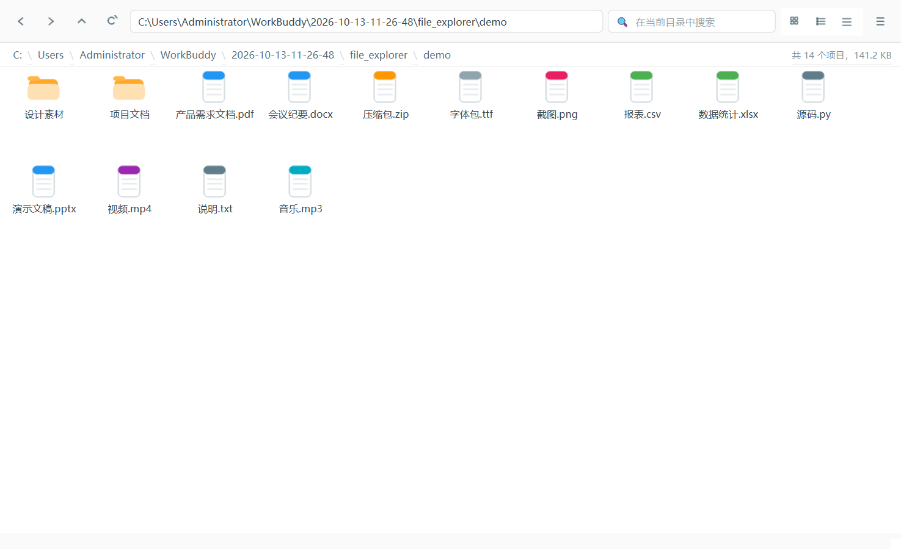
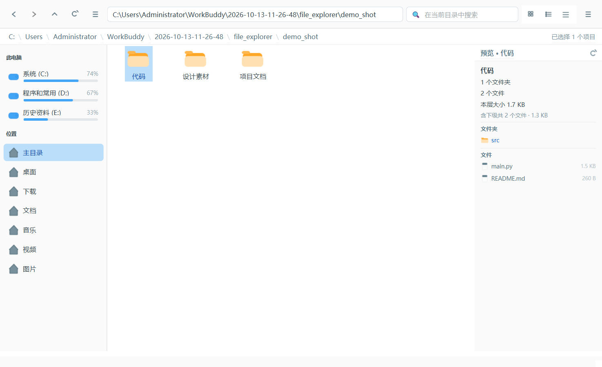
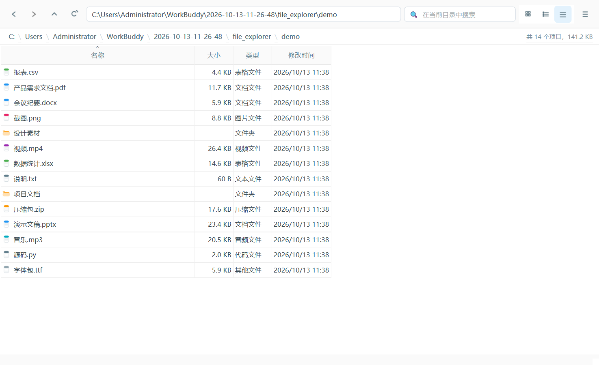

# Qt 资源管理器

一个用 Qt（PySide6）实现的桌面文件管理器，功能对齐 Windows 资源管理器。

**当前版本：1.01**







## 环境要求

- Python 3.10 或更高版本
- PySide6（首次运行会自动安装）
- Windows（macOS / Linux 可运行，删除语义略有差异）

## 快速开始

### 方式一：打包成 exe（推荐，无需装 Python）


双击 `build_exe.bat` 打包，之后直接运行 `dist\QtExplorer\QtExplorer.exe`：

- **不需要安装 Python**，Python 和 Qt 全部打包进去了
- **不会弹出任何控制台窗口**
- 可以整个文件夹拷走，或给 exe 建快捷方式

> `dist\QtExplorer` 是一个文件夹，里面有 exe 和 `_internal` 依赖目录，
> **两者必须放在一起**，exe 单独拷走会启动失败。

### 方式二：从源码运行

双击 `start.bat`，或在终端运行：

```bat
start.bat# 直接启动（会保留控制台窗口）
start.bat --check      # 自检：打印解释器路径与依赖版本，不启动界面
start.bat D:\某个目录  # 启动后直接打开指定目录
```

`start.bat` 会自动挑选可用的 Python（依次尝试项目内 `.venv`、WorkBuddy 托管环境、
托管环境的版本目录、系统安装的 Python、`py.exe` 启动器、`PATH`），并按需安装 PySide6。
依赖已就绪时不会重复安装。

> 如果希望完全独立于 WorkBuddy，可以自己建一个环境再双击 `start.bat`，它会优先使用
> 同目录下的 `.venv`：
>
> ```bat
> python -m venv .venv
> .venv\Scripts\python.exe -m pip install PySide6
> ```

脚本内所有提示文字均为 ASCII。原因：`.bat` 默认按 GBK 解析，混有中文时会出现
`'[提示]' 不是内部或外部命令` 这类解析错误，与 `chcp` 设置无关。

不想用批处理也可以直接运行：

```bash
python -m pip install PySide6
python run.py
```

## 功能清单

### 浏览

- 左侧**驱动器栏**分两组：上「此电脑」列出全部磁盘分区，下「位置」是主目录/桌面/下载/文档/音乐/视频/图片
- 每个分区合并为一条：图标 + 盘符名 + 卷标 + 已用百分比，下方一条**图形化容量条**
- 容量条配色随占用变化：<75% 蓝、≥75% 橙、≥90% 红
- 悬停显示完整信息（文件系统、剩余/总量、精确百分比）
- 侧栏随当前目录自动高亮所在盘（取最长路径匹配，不会被上级盘抢走）
- `F9` 或工具栏的 ≡ 按钮收起/展开侧栏，分隔条可拖拽调宽（收起后按钮仍在工具栏，可随时恢复）
- 三种视图：**大图标** / **列表** / **详细信息**，按 `Space` 快速循环
- 详细信息视图含名称、大小、类型、修改时间，点表头即排序
- 面包屑路径导航，每一级都可点击跳转，支持网络路径 `\\server\share`
- 前进 / 后退 / 上一级完整历史栈
- 地址栏直接输入路径回车跳转，`Ctrl+G` 打开「转到」对话框（带桌面/文档/下载等快捷入口）
- 文件夹始终排在文件前面

### 预览窗格

选中文件夹后，右侧预览窗格显示其下级内容，不用进入就能看到里面有什么：

- **文件夹**：列出下级文件夹与文件名、各自大小，并统计本层与含下级的累计项数/体积
- 每条前面都有**对应类型的图标**（文件夹、Python、PDF、文档等按扩展名着色），
  文件大小右对齐
- **图片**：直接显示缩略图与尺寸信息（jpg/png/gif/bmp/webp/ico）
- **其它文件**：显示类型、大小、创建与修改时间
- 预览里的条目**整行可点**：文件夹点击进入，文件用系统默认程序打开；
  鼠标悬停整行显示浅蓝底色，与资源管理器的操作手感一致
- 扫描在后台线程进行，点开大目录界面也不卡；连续点击只渲染最后一次的结果
- 多选或未选中时显示对应提示
- `F12` 或菜单「预览窗格」开关
- **单实例运行**：重复启动只会激活已有窗口，不会开出第二个主窗口

### 搜索

- 工具栏实时过滤当前目录，输入即筛
- 状态栏显示「共 N 个项目」与目录总大小

### 文件操作

| 操作           | 说明                                                     |
| ------------ | ------------------------------------------------------ |
| 新建           | `Ctrl+N` 文件夹、`Ctrl+Shift+N` 文本文件，名称非法字符会拦截，重名自动加 `(1)` |
| 复制 / 剪切 / 粘贴 | `Ctrl+C` / `Ctrl+X` / `Ctrl+V`，同名自动改名不覆盖               |
| 重命名          | `F2`，保留扩展名并预选主名                                        |
| 删除           | `Delete`，可选「移到回收站」或「永久删除」，可多选                          |
| 拖放           | 从外部拖文件进来即复制到当前目录                                       |

### 其它

- `Alt+Enter` 查看属性：位置、大小、包含文件数、创建/修改/访问时间、权限
- `Ctrl+Shift+A` 显示隐藏文件
- 右键菜单完整，含「复制路径」「在资源管理器中显示」「在此处打开命令行」
- 复制/删除都在后台线程执行，大目录带进度条，界面不卡
- 目录超过 2 万项时截断显示并提示，避免假死

## 快捷键一览

| 快捷键                   | 功能    | 快捷键            | 功能           |
| --------------------- | ----- | -------------- | ------------ |
| `Alt+←`               | 后退    | `Ctrl+N`       | 新建文件夹        |
| `Alt+→`               | 前进    | `Ctrl+Shift+N` | 新建文本文件       |
| `Alt+↑` / `Backspace` | 上一级   | `F2`           | 重命名          |
| `F5`                  | 刷新    | `Delete`       | 删除           |
| `Ctrl+L`              | 定位地址栏 | `Ctrl+C/X/V`   | 复制 / 剪切 / 粘贴 |
| `Ctrl+G`              | 转到    | `Ctrl+A`       | 全选           |
| `Space`               | 切换视图  | `Alt+Enter`    | 属性           |
| `F9`                  | 侧栏开关  | `Ctrl+R`     | 重新枚举磁盘       |
| `F12`                 | 预览窗格  |                |              |
| `F1`                  | 关于      |                |              |
| `Ctrl+Shift+A`        | 隐藏文件  |                |              |

## 代码结构

```
file_explorer/
├── run.py           # 入口：DPI 感知、图标、命令行参数（也是打包入口）
├── core.py          # 文件系统层：扫描、驱动器枚举、图标绘制、后台复制/删除、回收站
├── main_window.py   # UI 层：主窗口、驱动器侧栏、四个对话框、导航历史、主题
├── make_icon.py     # 生成 app_icon.ico（QPainter 绘制，多尺寸 ico）
├── build_exe.bat    # PyInstaller 打包脚本
├── verify_exe.py    # 枚举窗口验证 exe 是否真的显示 GUI
├── test_preview.py  # 预览窗格专项测试（41 项）
├── test_sidebar_toggle.py  # 侧栏收起/恢复测试（19 项）
├── test_single_instance.py  # 单实例保护验证
├── app_icon.ico     # 应用图标（7 种尺寸）
├── shoot_preview.py # 生成预览窗格演示截图
├── smoke_test.py    # 77 项无界面测试
└── start.bat        # 从源码启动（解释器探测与自检模式）
```

分层原则：**core.py 只管磁盘，main_window.py 只管界面**，两者不交叉，方便后续换存储后端或做单元测试。

几个实现要点：

- **打包用 `--windowed`**：编译期就决定不创建控制台，所以 exe 运行时不会有黑框
- **默认 `--onedir` 而非 `--onefile`**：onefile 的 bootloader 在部分机器上会把进程
  卡在 `PyInstaller Onefile Hidden Window`，GUI 永远不出现（实测踩过）。onedir 直接
  运行 exe，没有中间层，更可靠
- **预览扫描在后台线程**：`moveToThread` 之后必须用 `QMetaObject.invokeMethod`
  队列调用，**直接调用槽函数会被 Qt 拒绝**（对象不属于当前线程）
- **单实例用命名互斥体**：名字带会话 id（`Local\QtExplorer_<名称>_<sid>`），
  第二次启动时 `EnumWindows` 找到已有窗口并 `SetForegroundWindow` 激活，然后退出
- **驱动器枚举**用 `QStorageInfo` 而非 `os.listdir`，因为它能拿到卷标、文件系统类型和容量；卷标再用 Win32 `GetVolumeInformationW` 兜底读取
- **图标全部代码绘制**，无外部图片依赖：文件按扩展名分 9 类配色，驱动器按磁盘/U盘/光驱/网络/主目录分别绘制
- **后台线程**用 `QThread` + `Signal`，UI 线程只收信号刷新
- **回收站**走 Windows Shell COM 的 `InvokeVerb('delete')`，跨平台时回退 `send2trash`
- **矢量按钮图标**用 `QPainter` 画线条，避免 `←` `⟳` 等字符在缺字字体下变方块
- **侧栏容量条**同样是 `QPainter` 画的（`UsageBar`）：圆角底槽 + 圆角填充，
  按占用率变色（<75% 蓝、≥75% 橙、≥90% 红），只占 5px 高

## 运行测试

```bash
QT_QPA_PLATFORM=offscreen python smoke_test.py
```

覆盖尺寸格式化、目录扫描、三视图渲染、排序、搜索、选择、前进后退、空目录、无效路径，
以及真实的复制、移动、冲突改名、删除；另外检查启动脚本的编码换行与打包配置、图标多尺寸可用性、
已构建 exe 是否存在。

验证打包产物能否真正显示窗口（枚举 exe 的顶层窗口，确认 `visible=True` 且无控制台类窗口）：

```bash
python verify_exe.py
```

## 已知的取舍

- **打包产物是一个文件夹而非单个 exe**：exe 1.7 MB，但需要 `_internal` 依赖目录
  （合计约 114 MB）才能运行。这是为绕开 onefile bootloader 卡死的问题，见上文实现要点
- 删除对话框分「回收站」和「永久删除」两档，**没有 Undo**，误删需自行去回收站还原
- 属性窗口对文件夹会递归统计子项，巨大的目录树（数十万文件）统计需要几秒
- 不做磁盘占用分析和文件预览，属于取舍后的简化
- 仅支持本机路径语义，跨平台差异（尤其 macOS/Linux 的删除语义）未做适配
- 打包的 exe 只在 Windows 上可用；PySide6 本身跨平台，但本次未做 macOS/Linux 打包验证
